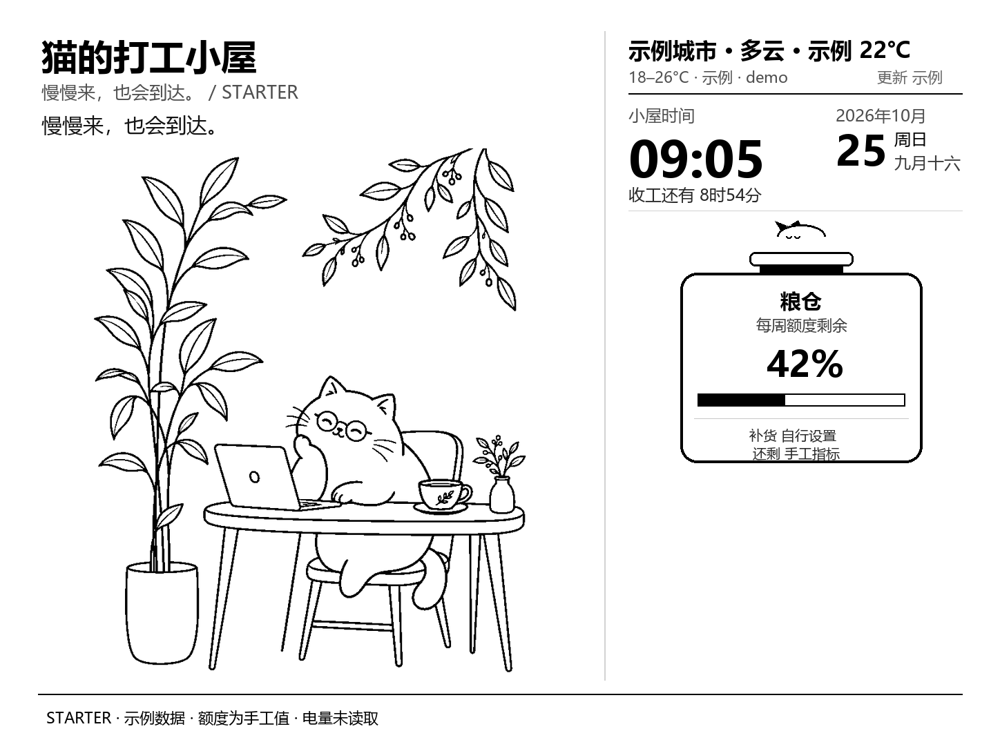

# Kindle Dashboard Starter

把闲置 Kindle 做成自己的本地看板：电脑负责编辑和生成图片，Kindle 负责显示。
包含本地 Web 控制台、三个可编辑模板、分区文字/图片/时钟/月历/进度模块、
USB 推送、恢复阅读、整屏试图和可选的 Wi-Fi/RTC 自动刷新。



## 从这里开始

**先在电脑上跑通，再接 Kindle。** 默认示例模式不需要 Kindle、SSH、API Key 或天气网络请求。

1. [电脑安装与编辑](docs/01-local-console.md) — 所有人必读。
2. [Kindle PW3 越狱与基建实战指南（脱敏修订版）](docs/JAILBREAK_AND_BASE_SETUP.md) — 从零准备设备时必读；涵盖 LanguageBreak、Hotfix、MRPI、KUAL、USBNetwork 和 Windows 网卡。
3. [Kindle 准备与 USB 显示](docs/02-kindle-usb.md) — 已有底座后，安装看板、推送和验证恢复阅读。
4. [Wi-Fi / RTC 自动刷新](docs/03-auto-refresh.md) — 需要自动更新时读取。
5. [故障排查](docs/TROUBLESHOOTING.md) — 按遇到的问题读取。
6. [开发与分享边界](docs/DEVELOPMENT.md) — 改代码、打包或发布时读取。

让 AI agent 帮忙部署，可直接复制 [给朋友的 AI agent 执行指令](docs/AI_AGENT_START.md)。

后续新会话也从本 README 进入；不同阶段只读取对应教程，避免把旧实验记录当成当前操作步骤。

## 五分钟电脑预览（Windows PowerShell）

需要 Python 3.10+；在本文件所在文件夹打开终端：

```powershell
python -m venv .venv
.\.venv\Scripts\python.exe -m pip install -r requirements.txt
.\.venv\Scripts\python.exe src/web_console.py --host 127.0.0.1 --port 8001
```

打开 <http://127.0.0.1:8001>。以后可双击 `start_console.bat`。
安装依赖后，默认预览可完全离线使用。

## 数据来自哪里

| 内容 | 来源与边界 |
| --- | --- |
| 时钟、公历、农历、月历 | 图片生成时的电脑本地日期和时间；农历使用 lunar-python 计算 |
| 天气 | 默认明确标注为示例；手动启用 Open-Meteo 并填写经纬度后才联网，缓存三小时 |
| 额度、进度、电量、节点状态 | 手工输入或示例；没有读取个人 AI 账号、主机监控或 Kindle 电量的采集器 |
| 前光 | USB 推送时应用所选亮度，整屏试图不调整亮度 |
| 插画 | AI 生成的工作猫、休息猫线稿；支持换成自己的图片，见 [素材说明](assets/ASSETS.md) |

仓库提供三种编辑画布：猫咪、双历、节点示例。六张预制整屏示例是固定图片，
用于快速试屏，不代表六种独立可编辑布局。默认不存在自动息屏时段、账号同步或秒级时钟。

## 兼容范围和验证边界

- 设备脚本面向 **Kindle Paperwhite 3 / 1072×1448**；横屏编辑为 1448×1072，输出时旋转。
- 原项目的设备经验来自 PW3；朋友自己的型号、固件、USBNetwork、显示和按键恢复仍需逐项验证。
- 自动模式涉及设备系统、Wi-Fi 和 RTC；不熟悉时先只使用静态 USB/缓存模式。
- 本 starter 的本地验证记录见 [验证说明](docs/VALIDATION.md)。没有据此宣称朋友设备已验证，也没有续航承诺。
- Windows 是本轮验证环境；Linux/macOS 提供启动说明，未在对应系统实测。

运行数据位于 `~/.kindle-dashboard-starter/`，可用 `KINDLE_DASHBOARD_DATA_DIR` 指定其他目录。
项目不迁移或读取其他应用的旧配置。默认仅本机可访问；可选 LAN 模式只开放图片端点。

## 许可

代码采用 [MIT License](LICENSE)，保留原作者版权声明。
素材说明见 [assets/ASSETS.md](assets/ASSETS.md)；Python 依赖通过 pip 安装，遵循各自许可，未捆绑分发。
公开源码与教程：[qianzhouyang/kindle-dashboard-starter](https://github.com/qianzhouyang/kindle-dashboard-starter)。
